# 5G Auth Toolkit Log, Part 2: SOC and Detection

Oct 29, 2026 · @BK

## What is MILENAGE, SUCI and 5G-AKA?

Every time your phone connects to a mobile network, the phone and the network have to answer two questions: are you who you say you are, and how do we keep this connection private? In 5G this is solved with three pieces, and this project implements all of them.

- **MILENAGE** is the maths inside the SIM card. The SIM and your operator both know the same secret key (K). From that key and a random number, they can each calculate the same answers without ever sending the key itself.
- **SUCI** hides who you are. Older networks often sent your permanent ID (IMSI) in clear text, and fake base stations called IMSI catchers used that to track people. In 5G the phone encrypts its ID with the operator's public key before sending it, so only the real home network can read it.
- **5G-AKA** is the actual login. The network sends a challenge, the phone checks that the challenge really came from its own operator, and then answers. If both sides are happy, they end up with the same session key, again without sending it.

There are three parties in the logs further down. **UE** is the phone. **SEAF** is the network you're connected to right now, which can be another operator if you're abroad. **AUSF/SIDF** is your own operator (the home network), which is the only one that knows your secret key.

## Status

This is my working log for the SOC and detection side of the project. Part 1 covered building the crypto and the protocol: MILENAGE, SUCI, 5G-AKA and an attack simulator. Every attack there was **blocked**, but nothing recorded that it happened. This part adds the other half: making the network **log** what happens, getting those logs into Splunk, and building a lab where attacks are hidden in realistic traffic so I can practise finding them.

So far the network logs every login and every failure as JSON, the logs load into Splunk with all fields extracted, and the detection work now has its own public repo, `5g-detection-lab`. The traffic generator is next.

| Check | Result |
| --- | --- |
| Splunk installed, `fiveg` index created | Done |
| `events.py`: JSON events with pseudonymised subscribers | Done, pushed |
| Home network logs logins and failures (parts A and B) | Done, pushed |
| Test events uploaded to Splunk and searchable | Done, fields extracted with source type `_json` |
| Serving network reports phone-side failures and the cell (part C) | Done, pushed |
| Configurable clock in `EventLog` (generator step 1) | Done, pushed |
| Separate `5g-detection-lab` repo set up | Public repo on GitHub, pushed |
| Traffic generator with four hidden attacks, command and tests (steps 2 to 6) | Done, tested end to end |
| Splunk detections and dashboard | Four rules saved, 4 of 4 attacks found, no false positives. Dashboard done |

## Where this starts

Everything here builds on [5G-Auth-Toolkit](https://github.com/BaboucarrKah/5G-Auth-Toolkit), which is now public. It implements MILENAGE, SUCI concealment (ECIES Profile B) and 5G-AKA in Python, checked against the official 3GPP test vectors, and has a simulator that runs a full registration between a phone, a serving network and a home network. The full build log for that part is in Part 1.

The simulator has four built-in attacks. Each one is blocked by a different check, and these four are what the detection lab will hide in normal traffic and try to find again:

| Attack | What the attacker does | What stops it | Error in the logs |
| --- | --- | --- | --- |
| Replay | Records a real challenge and sends it to the phone again | The phone has already seen that sequence number | `SYNCH_FAILURE` |
| Fake base station | Sends its own challenge without knowing the subscriber key | The MAC in the challenge can't be made without the key | `MAC_FAILURE` |
| Tampered SUCI | Flips a bit in the encrypted identity | The tag on the SUCI no longer matches | `SUCI_INVALID` |
| Rogue network | Reuses a challenge made for another network | RES\* is tied to the network name | `RES_MISMATCH` |

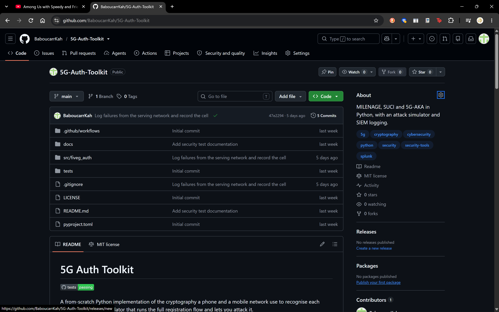

## SOC extension: setting up Splunk

In Part 1 every attack was **blocked**, but nobody would have **noticed** that someone tried. In a real mobile network that's only half the job. A security operations centre (SOC) needs to see that a fake base station is active in an area, or that someone is replaying challenges, so they can respond. That's what this part adds.

The plan has four steps:

1. **Structured logging:** every login and every failure becomes one JSON event.
2. **A traffic generator:** a simulated hour of normal traffic from about 200 subscribers, with attack campaigns hidden inside it.
3. **Detection in Splunk:** searches that find each attack without raising alarms on normal noise.
4. **Dashboard and documentation:** each detection rule explained, including false positives and a mapping to MITRE FiGHT (MITRE's threat model for 5G).

### Installing Splunk

I installed **Splunk Enterprise 10.6.1.1** for Windows. It starts with a 60-day trial with everything included, and can then be switched to the free licence, which allows 500 MB of data per day. That's far more than this project needs.

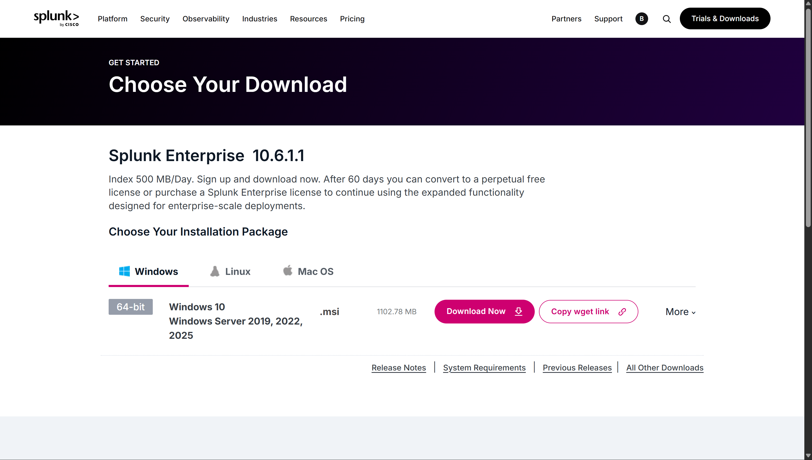

I kept the default install options. The most important one is that Splunk runs as a **non-administrator service account**. That's least privilege: if Splunk ever had a vulnerability, an attacker wouldn't get admin rights on my PC. The side effect is that the service account can't read files on my Desktop, so I'll upload log files through the web interface instead.


I created my own admin user instead of using `admin`, which is the first thing anyone guesses, and a password with only ASCII characters (no æ, ø or å). When Windows asked about network access, I only allowed it locally. The free licence has no login at all, so anyone who can reach port 8000 becomes admin. Splunk should only be reachable from my own PC.

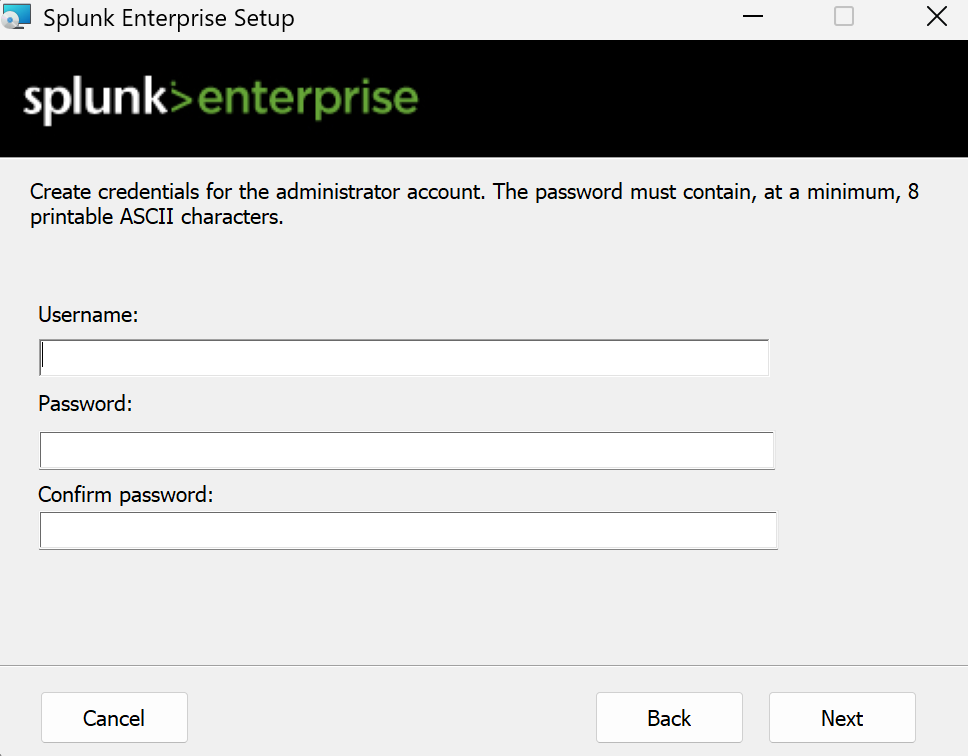

I also found out that USN students might be able to get free Splunk training and certifications through the Splunk Academic Alliance. Students can't sign up themselves, so the school has to enrol. That's something to ask about.

### Creating the `fiveg` index

An index is like a separate folder for data in Splunk. Giving the project its own index means I can search only this data, and easily wipe it and start again if the test data goes wrong. At first there was no `fiveg` index:

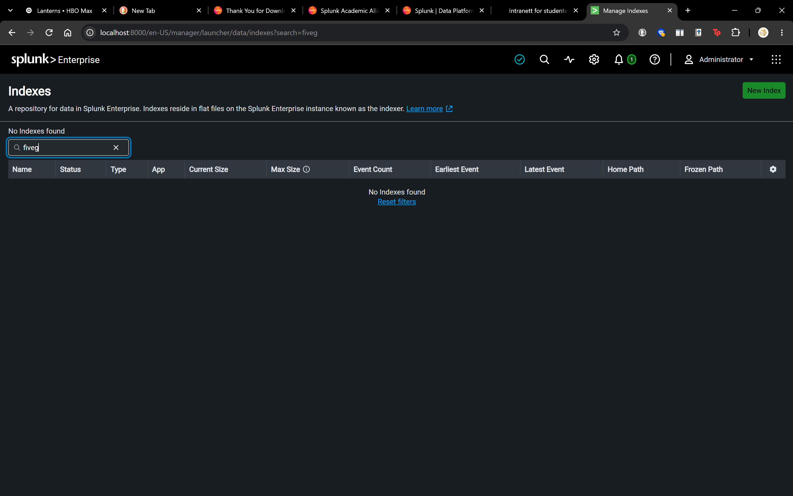

I created it under **Settings → Indexes → New Index**, with the name `fiveg` and type **Events**. Now it's active and empty, ready for data:

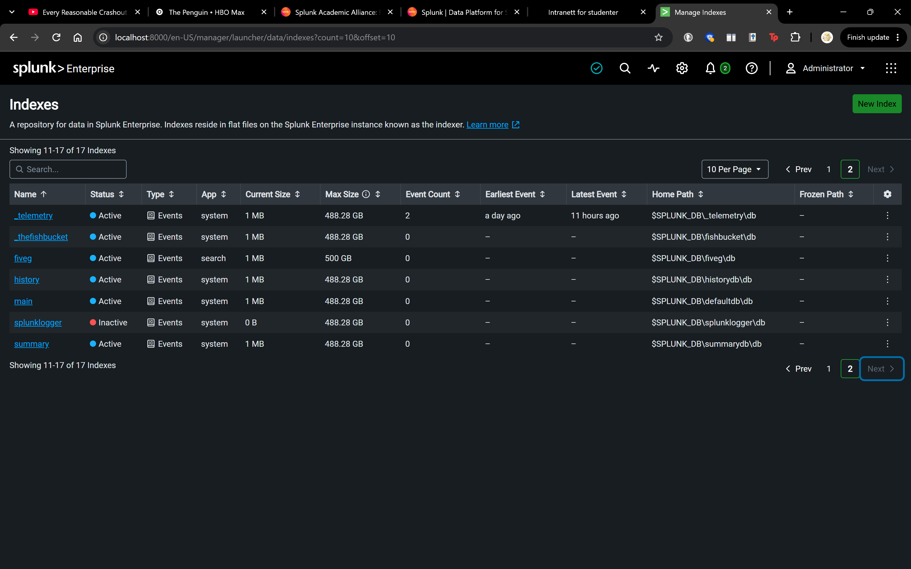

## SOC extension: writing `events.py`

This is the first file I wrote myself, line by line, instead of getting it finished. The job of `events.py` is to turn "something happened" into one line of JSON that Splunk can read, like this:

```json
{"time": "2026-10-29T12:27:14.663+00:00", "event_type": "auth_failure", "subscriber": "d903c3bb4be49795", "cell": "cell-07", "cause": "MAC_FAILURE"}
```

Splunk turns every field (`event_type`, `cell`, `cause` and so on) into something I can search and count on.

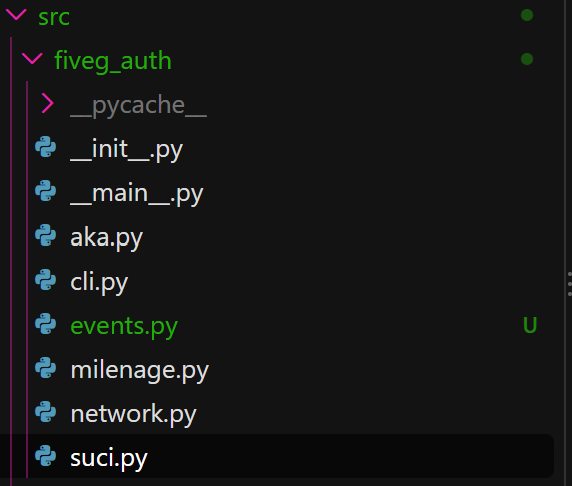

### Part 1: hiding who the subscriber is

The SOC needs to know if the same subscriber fails again and again, but the logs must not contain the real IMSI. Logs are read by many people and stored for a long time. So I log a **pseudonym** instead: a code that's always the same for the same person, but can't be turned back into the IMSI.

```python
def pseudonymize(supi: str, key: bytes) -> str:
    return hmac.new(key, supi.encode(), hashlib.sha256).hexdigest()[:16]
```

**Why HMAC with a secret key and not just SHA-256?** An IMSI is only 15 digits, and for one operator the first 5 are always the same. That leaves about 10 billion options, which a fast graphics card can hash in a short time. A plain hash could be brute-forced back to the real IMSI. With HMAC you also need the secret key, which only the home network has.

The first time I tested it I got `ModuleNotFoundError: No module named 'fiveg_auth'`. The terminal line didn't start with `(.venv)`, because I had opened a new terminal and the virtual environment wasn't active. My project is only installed inside `.venv`, so the normal Python on my PC didn't know about it.

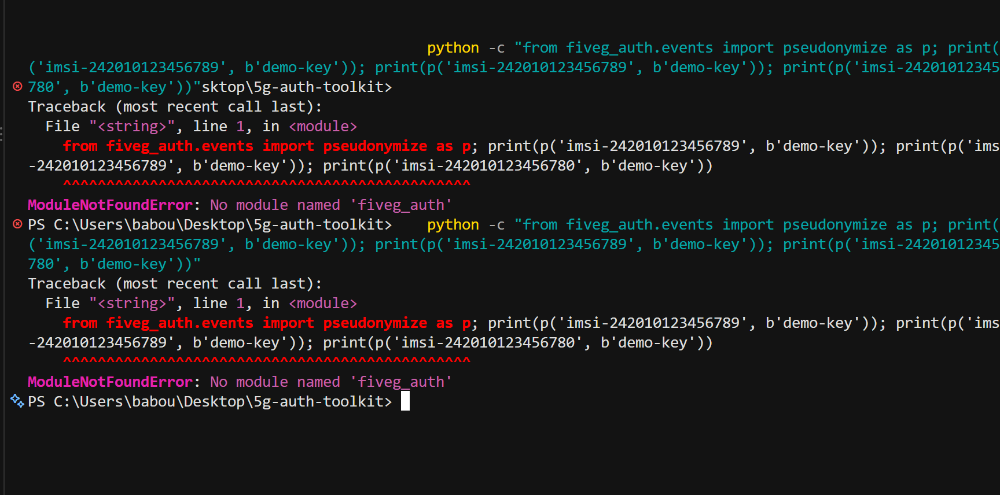

After `.venv\Scripts\activate` it worked. The same IMSI gives the same pseudonym twice, and changing just the last digit gives a completely different one:

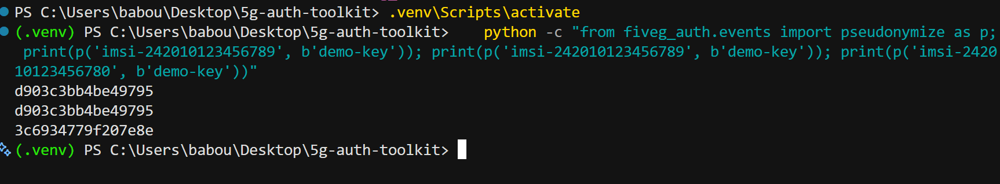

### Part 2: the `EventLog` class

The class has one job: build the event, swap the SUPI for a pseudonym, and write it as one JSON line. All times are in UTC, since logs from different time zones would be impossible to compare. The real SUPI goes in through one place only and is replaced straight away, so it can't end up in the logs by accident.

Writing it myself, I hit some real bugs:

- **`"out" is not defined`.** I named the parameter `log_file`, but used `out` on the next line. Pylance caught this one with a red underline before I even ran the code.

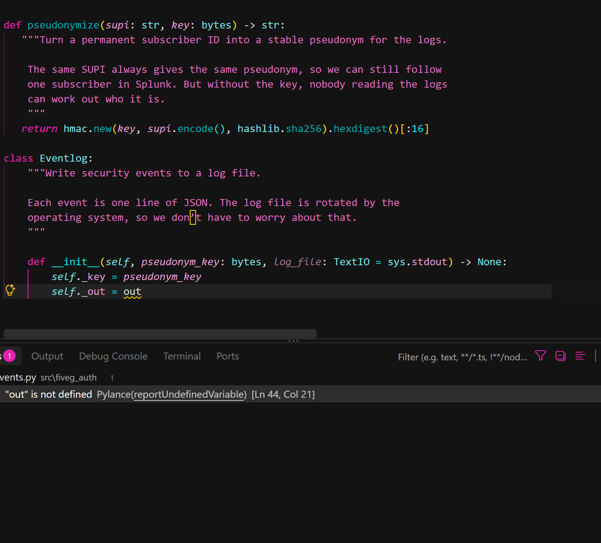

- **Two bugs Pylance didn't catch.** The class was called `Eventlog` instead of `EventLog`, which would give an `ImportError`. And I wrote `self.out.write(...)` instead of `self._out.write(...)`, which would crash with an `AttributeError` when the code runs. The bottom bar still said 0 errors, because Pylance doesn't always check what exists on `self`. These only show up when you actually run the code, which is why I test every piece.

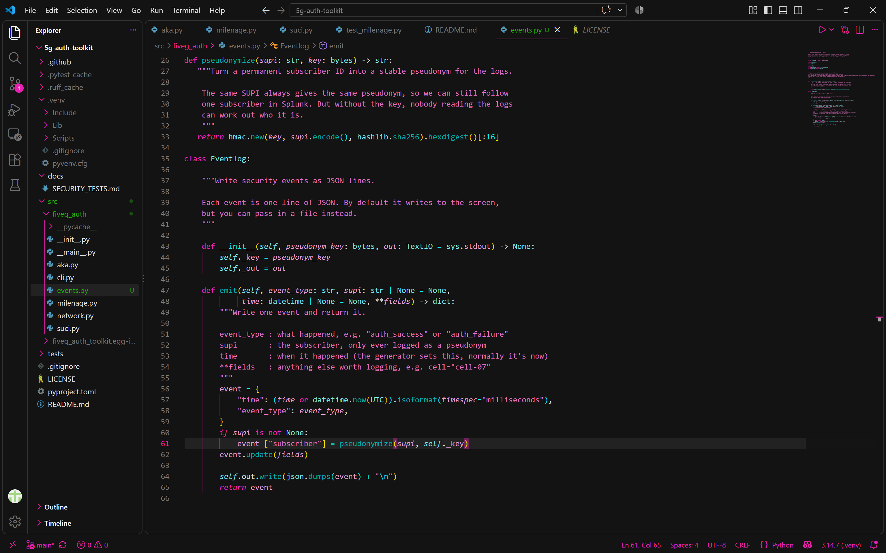

- **A comment that wasn't true.** My first docstring said the log file is rotated by the operating system. That's not something the code does. A wrong comment is worse than no comment, so I rewrote it to match what the code actually does.

After fixing those, the class worked:

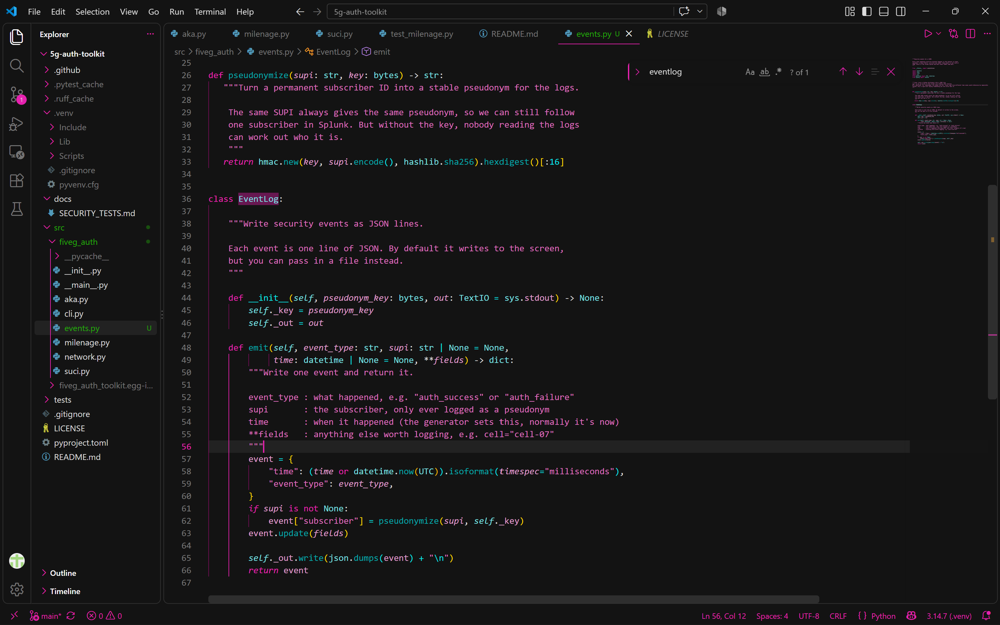

The test printed two JSON lines with the same pseudonym and the right fields. But `ruff` complained about the import block (`I001`). I had pasted my notes about the imports as a `"""text block"""` under the imports, with too many blank lines. A loose string in the code isn't a real comment, so I moved the notes into `#` comments next to each import. I also fixed the indentation in `pseudonymize`, which used 3 spaces instead of 4.

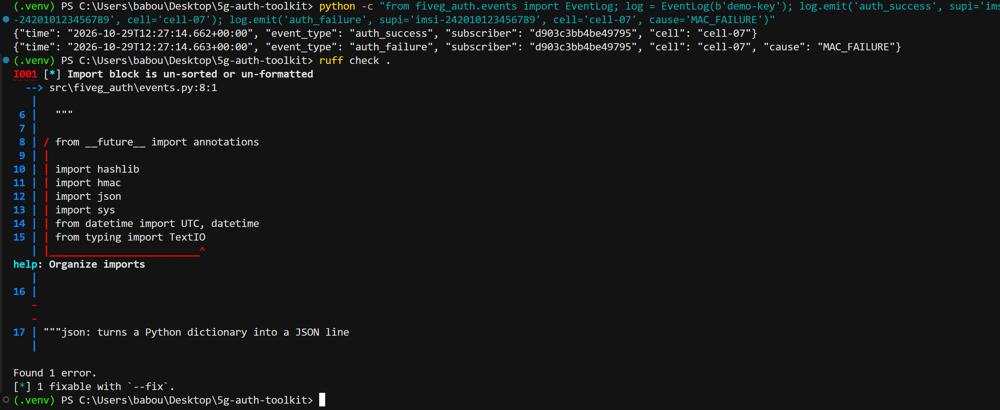

### Pushing `events.py`

Before committing I checked everything: `ruff check .` passed, `pytest` gave 30 passed, and `git status` showed `events.py` as the only new file.

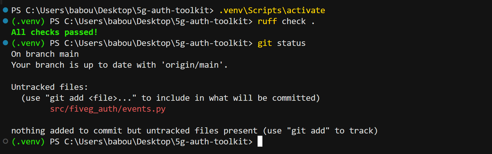

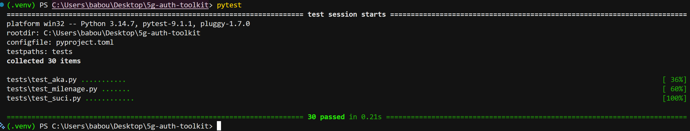

Then I committed and pushed. This time `git push` went straight through without a login, so the saved credentials from Part 1 work.

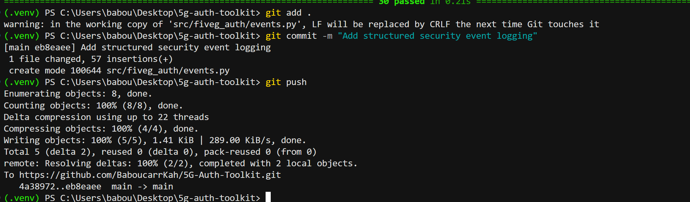

## SOC extension: connecting the network to the logs

`events.py` could write events, but nothing used it yet. The next job was to make the network itself log every login and every failure.

**Who should log?** The home network. It's the only party that knows *who* is logging in, because the SUCI is encrypted and only the home network can decrypt it. The serving network only sees an encrypted string that's different every time. This was an interesting thing to realise: the privacy protection in 5G (unlinkable SUCI) means only the home operator can tell that the same subscriber is being attacked again and again. So all events are written from `HomeNetwork`.

### Part A: giving the home network a place to send events

I made four small changes in `network.py`:

1. Imported `EventLog` from `events.py`.
2. Added an `events: EventLog | None = None` field to `HomeNetwork`. `None` means "don't log", so the tests and the normal simulator work exactly as before. Logging only switches on when you pass an `EventLog` in.
3. Made `_pending` remember four things per login instead of two: the auth vector, the network name, **who** it is and **which cell** they're in. Without that, the home network wouldn't know who failed if the phone rejected a challenge later.
4. Wrote a small helper, `_event`, that builds the full SUPI and sends it to `EventLog`, where it's swapped for a pseudonym straight away. If we don't know who it is (for example a tampered SUCI), the subscriber is simply left out of the event.

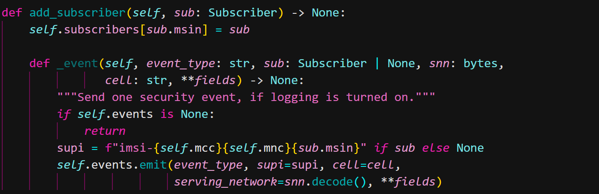

### Part B: logging success and failure

- **`authenticate`** got a `try`/`except` around the SUCI decryption. If it fails, it logs an `auth_failure` with no subscriber (we don't know who it is) and then passes the error on with `raise`. That `raise` matters: we only want to *log* the error, not *hide* it.
- **`confirm`** logs an `auth_failure` with the subscriber if RES\* is wrong, and an `auth_success` if the login works. A SOC needs the successful logins too, otherwise you can't tell what's normal.
- **`report_failure`** is new. Two of the four attacks (fake base station and replay) are rejected by the phone, not the home network, so the home network never sees them. This method lets the serving network report the failure back, the way a real 5G phone sends an *Authentication Failure* message.

### The bugs I hit on the way

**`AttributeError: 'HomeNetwork' object has no attribute '_event'`.** Two tests failed with this. The long error looked scary, but reading it from the bottom up explained it: the security checks worked fine (the SUCI was correctly rejected), and it was only the *logging* of that rejection that crashed. The line `During handling of the above exception, another exception occurred` is the key. After I re-aligned the `_event` method with the other methods in the class and saved, the error went away and all 30 tests passed again.

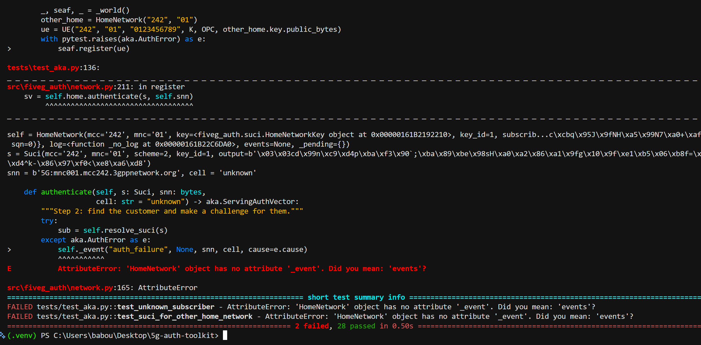

**`sub` and `cell` not defined.** In `confirm` I added the logging lines before changing the line that takes values out of `_pending`. It still only took out `av` and `snn`, so `sub` and `cell` didn't exist. VS Code showed it with yellow wavy lines before I even ran anything. The fix was to take out all four: `av, snn, sub, cell = self._pending.pop(rand)`. What goes in and what comes out has to match.

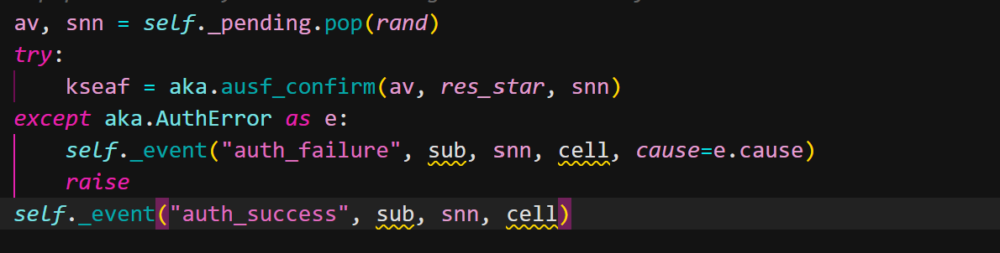

**A leftover line.** After rewriting `confirm`, the old `kseaf = aka.ausf_confirm(...)` line was still there at the bottom, so the RES\* check ran twice. It didn't crash, but it was confusing. Then, when removing it, I accidentally removed `return kseaf` too, which would have made every login fail. Lesson: after changing a method, read through the whole thing once.

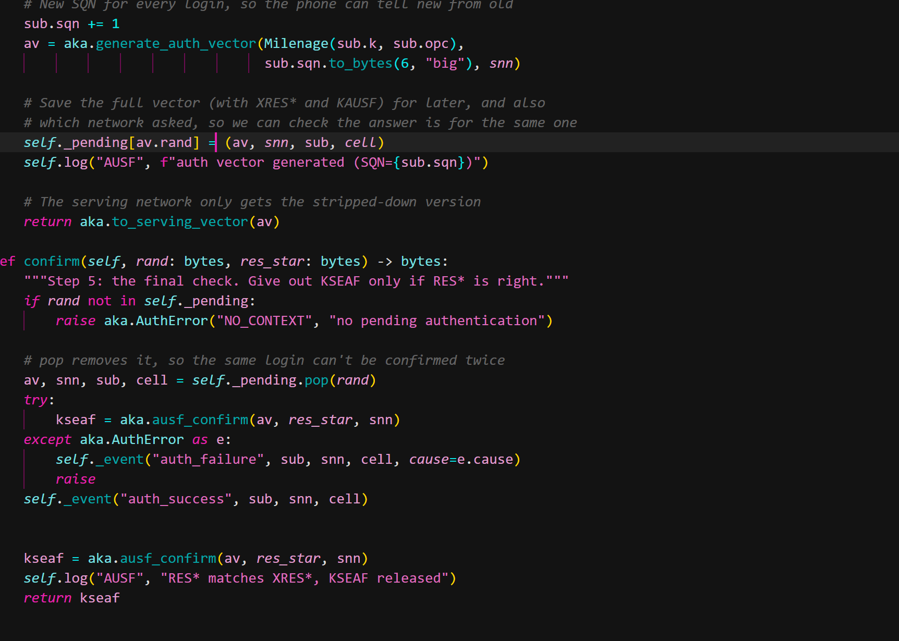

The finished `confirm`:

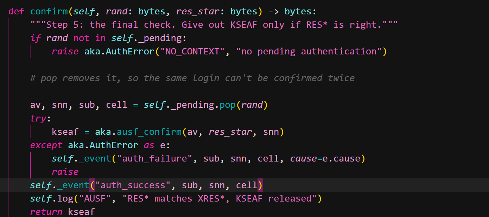

**A greyed-out parameter.** In `report_failure` I first only had the `if` check, and `cause` in the method signature was greyed out. VS Code greys out names that are defined but never used. That was the hint that the last two lines were missing.

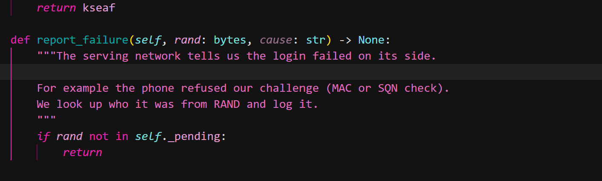

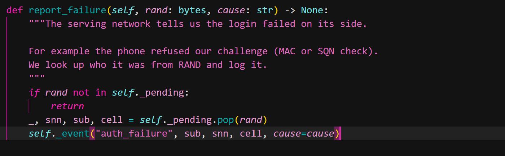

### The first real event

After the fixes, `pytest` gave 30 passed and `ruff` was green. Then I ran a login with logging switched on, and got the first real security event from my own network:

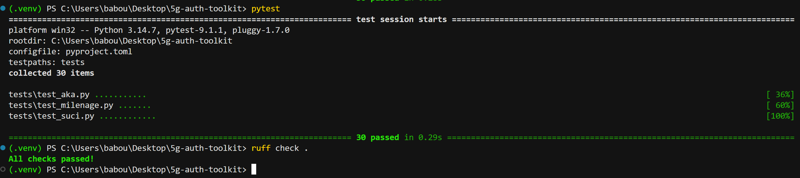

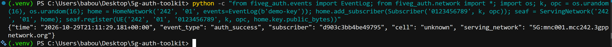

`cell` says `unknown` because the serving network doesn't pass the cell on yet. That's the next step.

When committing, PowerShell got stuck on `>>` because I forgot the opening quote in the commit message. `>>` means PowerShell is waiting for a quote or bracket to be closed, and Ctrl + C gets you out. With both quotes it worked, and the push went through.

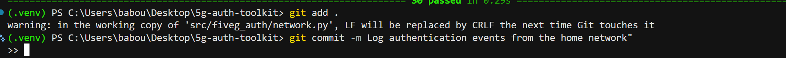

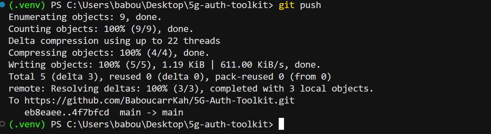

## SOC extension: first events in Splunk

So far the events were only written to the screen, and Splunk can't see my screen. Before building the traffic generator, I wanted to check that the whole chain works with just two events: **code → file → Splunk → search**. If something was wrong with the format, it's better to find out with 2 events than with 5,000.

### Writing events to a file

`EventLog` takes an `out` parameter, so instead of the screen I passed it a file. That gave me `test_events.jsonl` with two lines: one `auth_success` and one `auth_failure` with `MAC_FAILURE`, both with the same pseudonym. The `.jsonl` ending means JSON Lines, one JSON object per line.

Before creating it, I added `*.jsonl` to `.gitignore` so log files never end up on GitHub. The first time it didn't work, because I hadn't saved `.gitignore` (there was a white dot on the tab). After saving, the file no longer showed a **U** in VS Code, so Git ignores it.

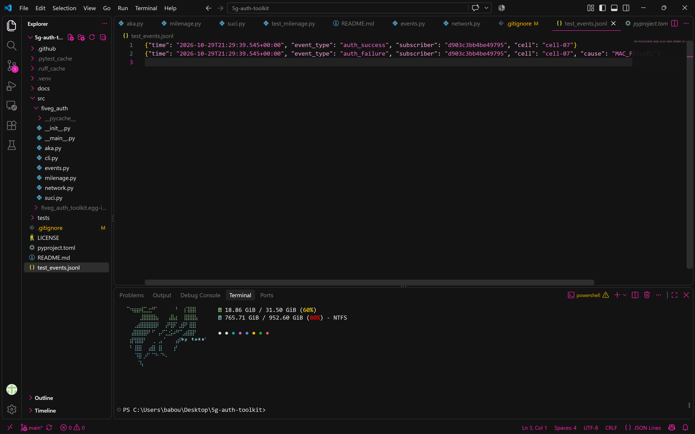

### Uploading to Splunk

I used **Settings → Add Data → Upload**. On the source type page I picked **Structured → \_json**. Splunk then split every event into separate fields (`cause`, `cell`, `event_type`, `subscriber`, `time`) and read the timestamp correctly, which shows the JSON format from `events.py` works without any extra setup.

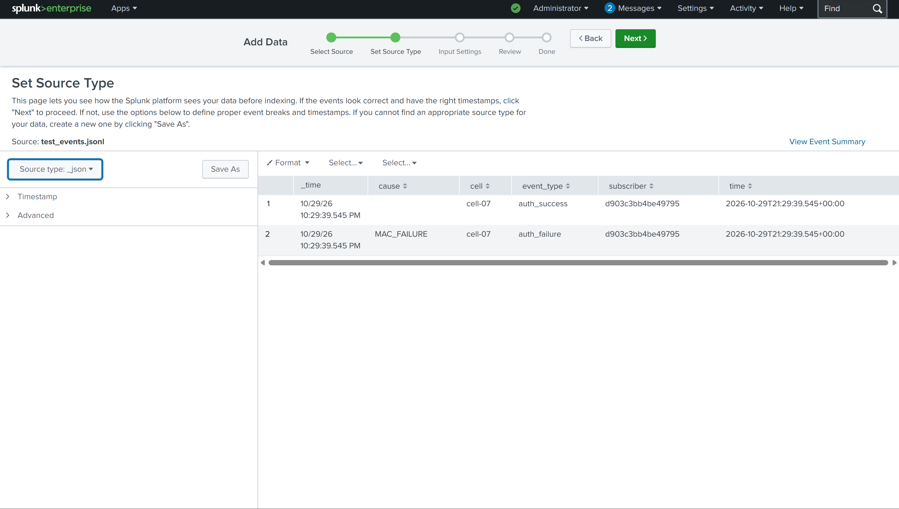

Under input settings I picked the `fiveg` index, so the project data stays separate from everything else in Splunk.

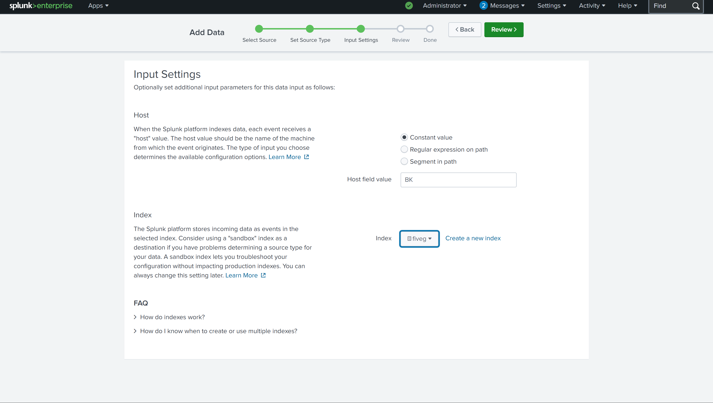

### Searching

A search for `index=fiveg` found both events. On the left, Splunk lists `cause`, `cell`, `event_type` and `subscriber` as fields I can search, filter and count on. This is exactly what the detection rules will use later, for example "count `auth_failure` with `cause=MAC_FAILURE` per `cell`".

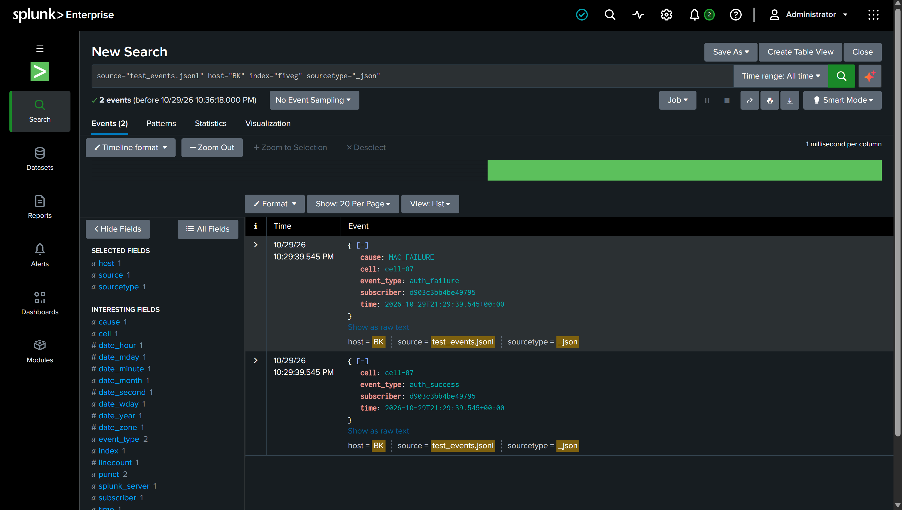

The full chain works: from a login in my own 5G simulator, through a JSON log file, into Splunk.

## SOC extension: logging failures the phone sees (part C)

After parts A and B, the home network logged two kinds of failure: a tampered SUCI and a wrong RES\*. But two of the four attacks are rejected **by the phone**, not the home network: the fake base station (`MAC_FAILURE`) and replay (`SYNCH_FAILURE`). The phone says no to the serving network, which never passed it on, so these two attacks would have been completely invisible in Splunk. The `cell` field also always said `unknown`, because the serving network never told anyone which base station the phone was using.

Part C fixes both in `ServingNetwork.register`:

1. `register` takes a `cell` argument and passes it on to the home network. In a real network the serving network always knows which cell a phone is connected through, and that's exactly what's needed to spot a fake base station: lots of failures from **one** cell.
2. If the phone rejects the challenge, the serving network catches the error, calls `report_failure` on the home network with the cause, and then passes the error on with `raise`. This is like a real 5G phone sending an *Authentication Failure* message back.
3. If the serving network's own RES\* check fails, it reports that too, before raising the error.

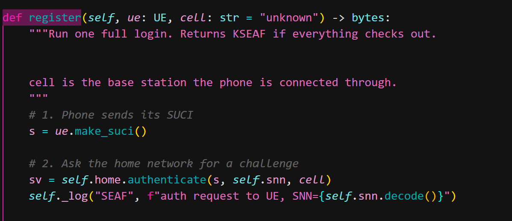

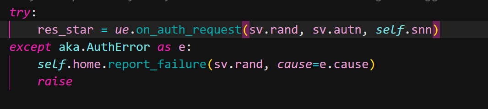

The first time, I forgot the report in step 4 (the serving network's own check). It's easy to miss because nothing breaks: the code runs fine, the failure just never shows up in the logs. The new line has to come **before** `raise`, because `raise` stops the method straight away.

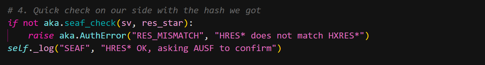

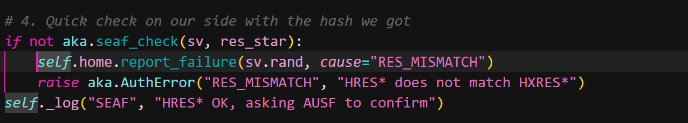

All 30 tests still passed.

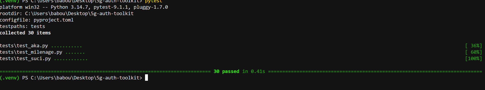

### Testing that phone-side failures are logged

I ran two logins with logging on: a normal phone on `cell-07`, and a phone with the wrong secret key on `cell-03`. To the phone, the second looks exactly like a fake base station: the MAC doesn't match, so it refuses to answer.

Both were logged with the right cell. The failure even has a `subscriber`, although it was the phone that refused: the home network looked up who it was from RAND. Before part C this failure would not have appeared in the logs at all. The red traceback after the events is expected, since the second login is supposed to fail, and the event was written before the error.

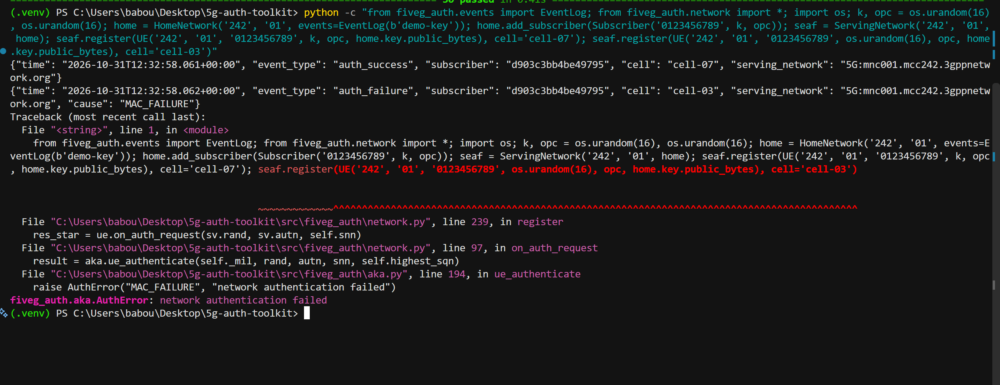

I committed part C together with the `.gitignore` change. Git showed `2 files changed`, and `test_events.jsonl` stayed out, so the ignore rule works.

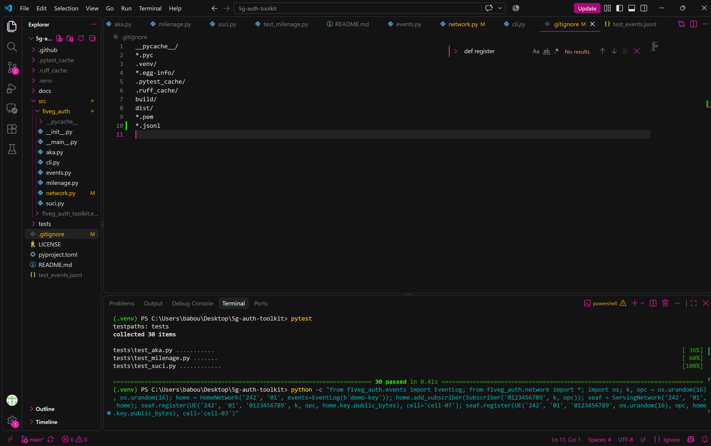

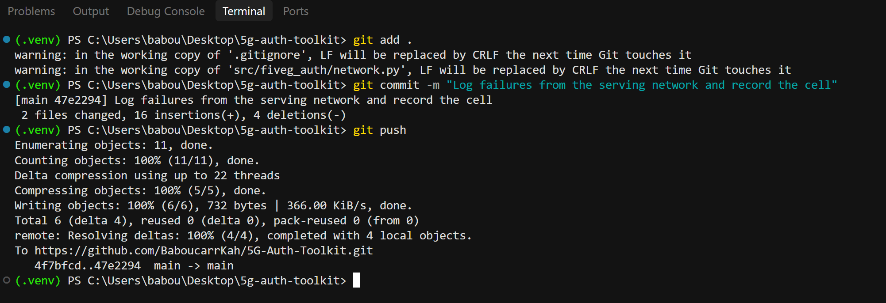

## Traffic generator, step 1: a clock I can control

The next big piece is a traffic generator: a simulated hour of logins from about 200 subscribers across about 12 cells, with normal noise and hidden attack campaigns. The plan:

1. A clock the generator can control
2. Setup: home network, subscribers and cells
3. Normal traffic, plus harmless noise
4. Four attack campaigns hidden in the traffic
5. A command to run it
6. Tests

**Why a clock?** The generator runs an hour of traffic in a couple of seconds. If every event got the real time, all of them would land within the same second, and Splunk couldn't see patterns like "10 failures from one cell in 5 minutes", which is exactly what detection rules look for. So `EventLog` needed a clock the generator can move forward itself.

I made three changes in `events.py`:

- a small `utc_now()` function that returns the real time in UTC, used as the default clock
- a `clock` parameter on `EventLog`, typed as `Callable[[], datetime]`, meaning "something you can call with no arguments that returns a datetime"
- `emit` asks `self._clock()` for the time instead of `datetime.now(UTC)`

One detail I had to get right: the default is `clock=utc_now` **without** parentheses, because I pass in the function itself. `self._clock()` **with** parentheses is where it's called, every time an event is written.

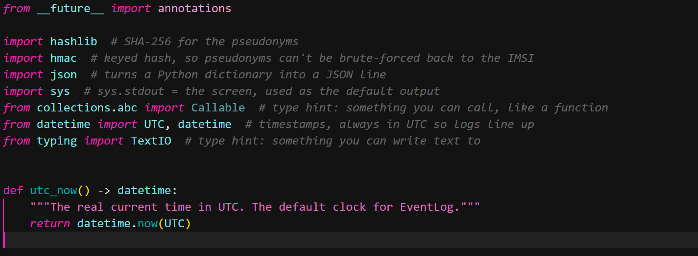

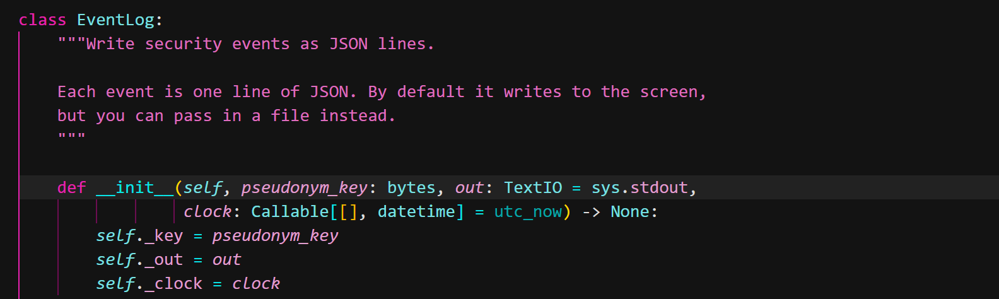

**The bug that breaks nothing.** I first forgot to change the line in `emit`, so it still used `datetime.now(UTC)`. The code ran fine, ruff was happy and all 30 tests passed, because nothing crashes when the clock is simply ignored. The generator would just have got real time on every event. That's why I tested with a fixed clock: it's the only check that proves the clock is actually used.

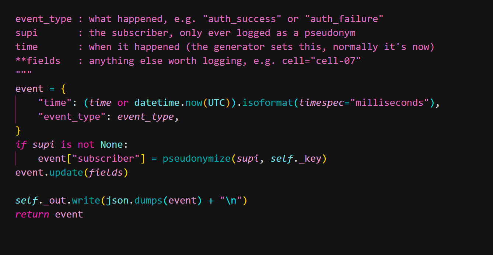

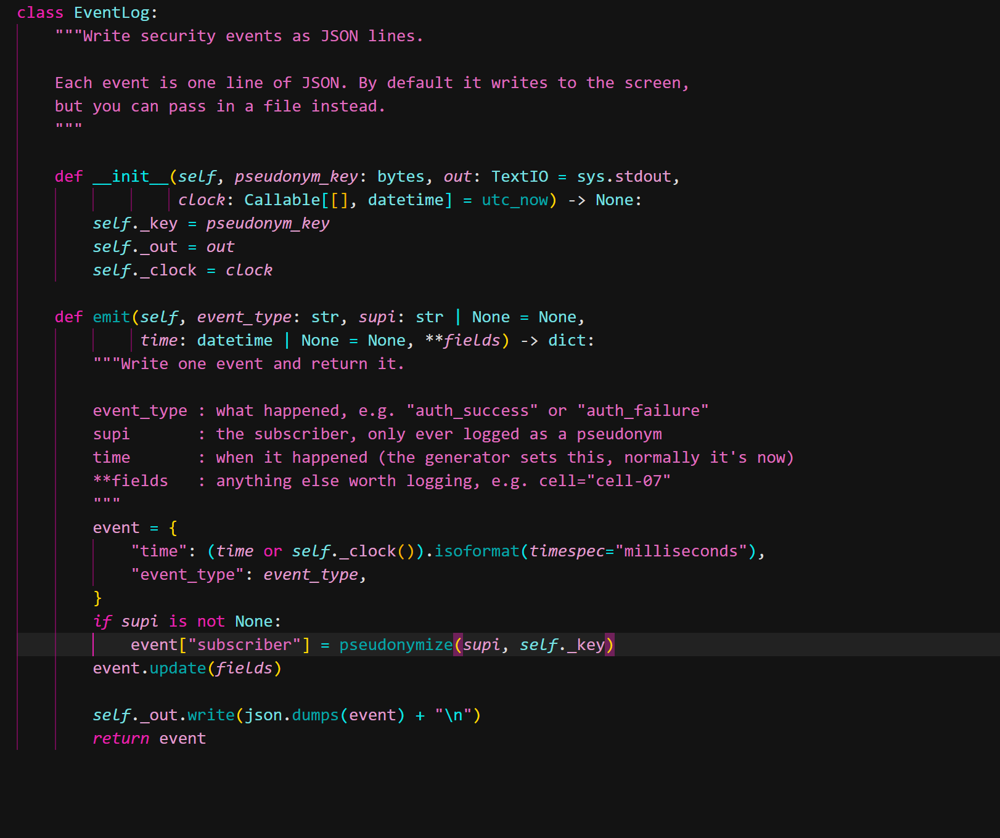

After the fix, tests and ruff were green, and an event written with a clock fixed at 12:00 got exactly `2026-10-31T12:00:00.000+00:00` as its time, not the real time.

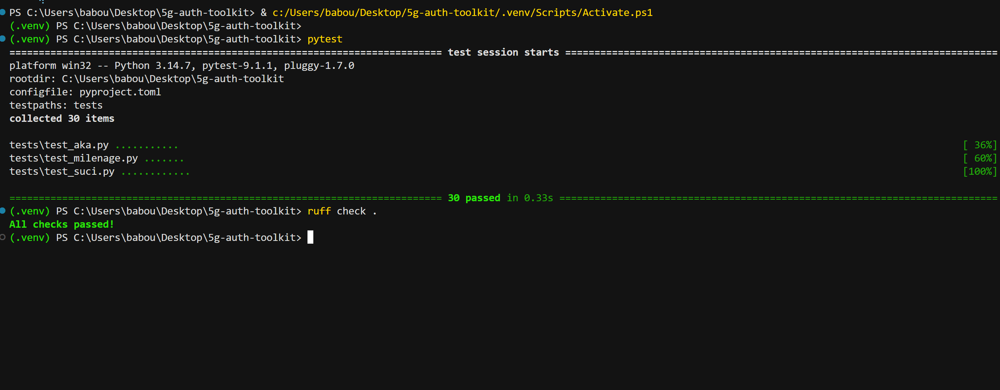

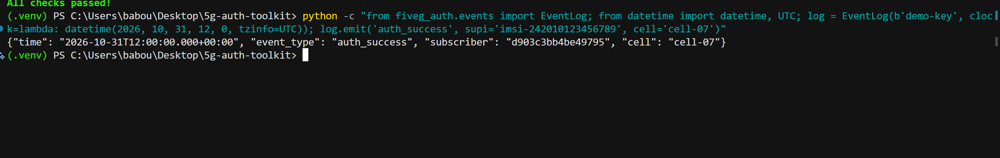

Then I committed and pushed the clock change to the toolkit.

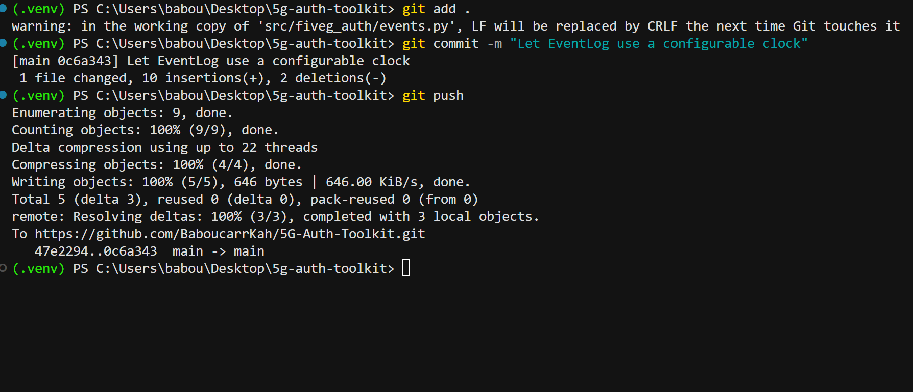

## Splitting the project into two repos

Before writing the generator I had to decide where it should live. I chose to split the project in two:

| Repo | What's in it | Shows |
| --- | --- | --- |
| `5G-Auth-Toolkit` | MILENAGE, SUCI, 5G-AKA, simulator, attacks, and the network's own logging | Crypto and protocol security |
| `5g-detection-lab` | Traffic generator, Splunk searches, dashboard, write-ups | SOC and detection engineering |

The logging code (`events.py`, the clock and the changes in `network.py`) stays in the toolkit. A real 5G core writes its own logs too, so that belongs with the network. Everything that *uses* those logs goes in the lab.

The reason for splitting is that each repo gets one clear purpose. Someone looking for SOC skills finds the detection lab directly, without digging past MILENAGE and SUCI. It also shows a clean structure: one library, and a separate project that depends on it.

### Setting up the detection lab

The lab lists the toolkit as a dependency in `pyproject.toml`, pointing straight at the GitHub repo:

```
fiveg-auth-toolkit @ git+https://github.com/BaboucarrKah/5G-Auth-Toolkit.git
```

So `pip install -e ".[dev]"` downloaded and built the toolkit from GitHub automatically, along with pytest and ruff.

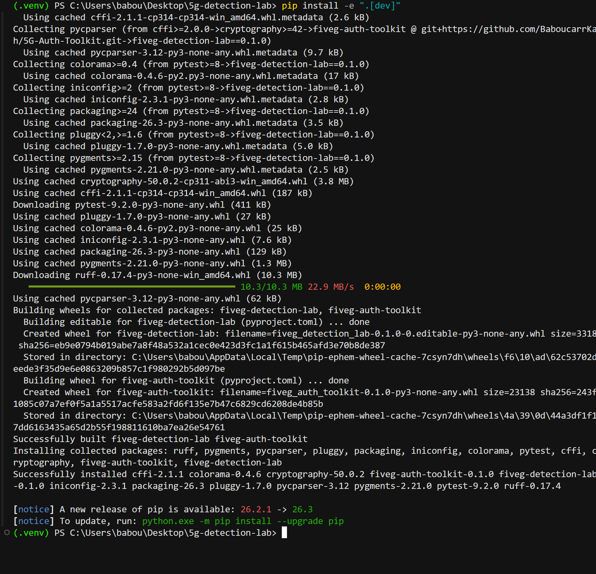

While I'm working on both at the same time, I don't want to push the toolkit every time I change something. So I installed my local copy over the GitHub one with `pip install -e ..\5g-auth-toolkit`. Now the lab sees toolkit changes straight away, while GitHub's CI still uses the version on GitHub.


The lab starts with two small tests that check it can see the toolkit, including the new clock. Both passed.


Then I created a public `5g-detection-lab` repo on GitHub and pushed. Before committing, `git status` listed 10 files, and neither `.venv` nor the `egg-info` folder was among them, so `.gitignore` worked. The two `.gitkeep` files keep the empty `data/` and `detections/` folders in Git until there's something in them.


The first CI run went green in 18 seconds. That was the real test of the setup: GitHub had to fetch `5G-Auth-Toolkit` from my other repo, install it, and run the lab's tests against it, including the check that the new clock is there. So the dependency between the two repos works.


## Traffic generator, step 2: the simulated clock and the lab

This is the first real code in the detection lab, in `src/detection_lab/generator.py`. I split it into two parts.

### 2a: a clock that only moves when I tell it to

In step 1 I made `EventLog` accept any clock. `SimClock` is the clock the generator gives it. It holds a "current time" that only changes when `advance()` is called. So the generator can say "wait 30 seconds" and it happens instantly, while every event still gets a realistic timestamp.

- `now()` takes no arguments and returns a `datetime`, so it fits the `Callable[[], datetime]` type from step 1. That means I can pass `clock.now` straight into `EventLog`.
- `advance()` adds a `timedelta`, Python's way of saying "a duration".
- The simulated hour always starts at the same fixed time (`START`, 1 November 2026 at 12:00 UTC). A fixed start makes the data reproducible.


The clock moved 90 seconds forward without waiting at all, and ruff was green.


### 2b: building the lab

`build_lab()` sets up the world the traffic will happen in:

- a `SimClock`, and an `EventLog` that uses it, so every event gets simulated time
- a home network that logs through that `EventLog`, and a serving network in front of it
- 12 cells, named `cell-01` to `cell-12`
- 200 subscribers, each with its own random K and OPc, registered in the home network
- a phone for each subscriber with the same keys, and a "home cell" it normally connects through

Two small dataclasses hold the result: `Phone` (a phone and its cell) and `Lab` (the clock, the networks, the cells and the phones).

**Reproducible on purpose.** All the randomness goes through `random.Random(seed)`. The same seed always gives the same keys and the same cells, so if I find an interesting pattern in Splunk, I can generate exactly the same data again. The pseudonym key is also fixed in the code. That's fine for a lab, but in a real system it would be a secret stored outside the code.


### What went wrong on the way

**A leftover import.** When I replaced the old `from datetime import ...` line with the new import block, part of the old line stayed behind at the top: `from datetime import UTC`. `UTC` was then imported twice.


**Nine ruff errors that weren't really errors.** After adding the imports but before writing `build_lab`, ruff reported 8 × `F401 imported but unused`. That was expected, since nothing used `random`, `dataclass`, `EventLog` and the rest yet. The important lesson: running `ruff check --fix` at that point would have *deleted* all those imports, because ruff thought they weren't needed. As soon as `build_lab` used them, all 8 disappeared on their own.


The only real issue was one blank line too many after `from __future__ import annotations`. Once all the imports were in use, it was safe to let ruff fix it with `--fix`, which only removed that blank line.


Also, a comment I was given on the `PSEUDONYM_KEY` line was over 100 characters, the limit set for this repo, so I shortened it.

### Testing the whole chain

Ruff only checks style, not whether the code works. So I ran one login through the lab from start to finish:

```python
import io
from detection_lab.generator import build_lab

out = io.StringIO()                       # a "file" in memory, so nothing is written to disk
lab = build_lab(out)                      # 200 subscribers, 12 cells, clock at 12:00
print(len(lab.phones), len(lab.cells))   # should print 200 12

p = lab.phones[0]                         # the first subscriber's phone
lab.clock.advance(300)                    # jump 5 minutes forward, instantly
lab.seaf.register(p.ue, cell=p.cell)      # one full 5G login through its home cell
print(out.getvalue())                     # the event the home network logged
```

What each line does:

- `io.StringIO()` acts like a file but lives in memory. `EventLog` can write to it exactly as it would write to a real log file, and I can read it back with `getvalue()`.
- `build_lab(out)` builds the whole lab: the clock, the networks, the cells and all 200 phones, with every event going to `out`.
- `lab.clock.advance(300)` moves the simulated clock 300 seconds forward. Nothing actually waits.
- `lab.seaf.register(...)` runs a real login with the crypto from the toolkit: SUCI, MILENAGE, 5G-AKA, all of it. The home network then logs the result through `EventLog`, which asks `SimClock` what time it is.

The output proves every part works together:

| What I checked | Result | What it proves |
| --- | --- | --- |
| Number of phones and cells | `200 12` | `build_lab` created the full lab |
| `time` | `2026-11-01T12:05:00.000` | The event got simulated time (start 12:00 + 300 s), not the real time |
| `event_type` | `auth_success` | A real login worked with the keys `build_lab` generated |
| `subscriber` | `4fc86ba71c2ffb4a` | The identity is pseudonymised. It's the same value every run, because the seed and pseudonym key are fixed |
| `cell` | `cell-08` | The phone logged in through its home cell, and part C passes the cell on |


Then I committed and pushed step 2 to the lab: one new file, `generator.py`, with 86 lines.


## Traffic generator, step 3: normal traffic and harmless noise

The attacks need something to hide in. This step creates an hour of ordinary logins, plus a small amount of harmless errors, so the log looks like a real network and not a clean test.

### 3a: an hour of normal logins

First I gave `Lab` its own random generator (`rng`), so the traffic uses the same seeded `random.Random` as `build_lab`. That way one seed decides everything: the keys, the cells and the traffic. The order matters: `rng` is the last field in the class and the last value in `return Lab(...)`, because a dataclass fills its fields in order.


Then `normal_traffic()` drives the simulated clock through one hour:

1. It works out when the hour ends, measured on the simulated clock.
2. In a loop, it waits a random time until the next login, picks a random phone, and logs it in.
3. Most of the time the phone uses its home cell. About 20% of the time it uses another cell, because people move around.
4. When the clock passes the end of the hour, the loop stops and returns a short summary.

**Why `expovariate`?** The time between logins comes from `rng.expovariate(logins_per_minute / 60)`. With 20 logins a minute, the average gap is 3 seconds, but the gaps are random: sometimes two logins close together, sometimes a longer pause. This is a *Poisson process*, the standard way to model independent events like calls, web requests or logins. Real traffic looks like this, not like one login exactly every 3 seconds.

**No error handling on purpose.** `normal_traffic` doesn't wrap `register` in `try`/`except`. A normal login should never fail, so if one does, it's a bug, and I want the program to crash and say so instead of hiding it.

The test ran a full hour in under a second: 1162 logins, all `auth_success`, spread from 12:00:01 to 12:59:56 across all 12 cells.


### 3b: harmless noise

If the attacks are the only failures in the log, finding them is far too easy. The hard part of SOC work is separating **real attacks** from **ordinary errors that look like attacks**. So I added realistic noise.

The noise is a phone whose sequence counter has drifted. In a real network this can happen innocently, for example after a SIM has been used abroad or a phone has been reset. It looks like this in the logs:

1. The phone rejects the network's challenge with `SYNCH_FAILURE`, which is exactly the same error as a replay attack.
2. The network resynchronises the counter (in real 5G this uses a process called AUTS).
3. The phone tries again two seconds later, and it works.

About 1% of logins (`DESYNC_CHANCE = 0.01`) go through `resync()` instead of a normal login.


**Catching an error on purpose.** In `resync` the first login is *supposed* to fail, so it's wrapped in `try`/`except AuthError: pass`. The failure is already logged by the serving network before the error reaches this code, so there's nothing more to do with it. This is the opposite of `normal_traffic`, where a failure would mean a bug.

Ruff complained once more about the blank line between the standard library imports and the toolkit imports, which disappeared when I added the `AuthError` import. Since every import was in use, `ruff check --fix` could safely put it back.


### The result

The hour now has 1220 successful logins and 10 `SYNCH_FAILURE` events. The total changed from 1162 because the extra random check in each loop shifts the sequence of random numbers. It's still fully reproducible, just a different sequence.

The two events after the first failure show the noise pattern clearly: the **same** subscriber on the **same** cell fails at 12:01:18 and succeeds at 12:01:20, exactly two seconds later.


**Why this matters for detection.** `SYNCH_FAILURE` on its own doesn't mean an attack. What separates noise from a replay attack is the pattern around it: noise is **one** failure followed straight away by a success. A replay attack will look different, for example several failures in a row for the same subscriber without a quick recovery. That's exactly the kind of difference the detection rules will have to capture.

Step 3 is committed and pushed: 61 new lines in `generator.py`.


## Traffic generator, step 4: hiding the attacks

This is where the lab gets interesting. I wrote four attack campaigns and a `generate()` function that hides them inside an hour of normal traffic.

**How every attack is built.** Each attack is a loop: one attack action, then a few seconds of normal traffic, then the next action. Normal logins keep happening *during* the attack, just like in a real network. So the attack doesn't leave a suspicious quiet gap in the log, and it has to be found among ordinary events.

Each attack also returns a small record of what it was, where it happened and when. Together these form the **ground truth**: the answer key I'll use later to check whether my Splunk detections found the right thing.

| Attack | What happens | What the home network sees |
| --- | --- | --- |
| Fake base station | A man-in-the-middle base station in one cell flips one bit of the MAC in each challenge | 25 `MAC_FAILURE` from 25 different subscribers, all in one cell, over about 3 minutes |
| SUCI flood | Corrupted SUCIs sent in a burst from one cell | 40 `SUCI_INVALID`, all without a subscriber, in one cell |
| Replay | One captured challenge is replayed to a single target, again and again | 8 `SYNCH_FAILURE` for the same subscriber over about 4 minutes, with no quick success after |
| Rogue roaming | A foreign roaming partner gets challenges under its own name, then shows them to phones as the Norwegian network | 15 `RES_MISMATCH`, all from one foreign serving network |

### 4a: fake base station

A small helper, `flip_bit()`, returns a copy of some bytes with one bit flipped, like an attacker tampering with a message. The fake base station picks 25 different phones with `rng.sample` (which never picks the same one twice), lets the real network create a challenge for each, flips the last bit of the MAC, and gives it to the phone. The phone spots the forged MAC, refuses, and the failure is reported back.

Instead of calling `register`, the attack does the steps by hand (`authenticate`, the phone, `report_failure`), so it can step in between and tamper with AUTN, just like the attacker.


Run on its own: 25 `MAC_FAILURE`, all in `cell-07`, from 25 different subscribers. The one `SYNCH_FAILURE` in `cell-01` is harmless resync noise from the normal traffic in between.


### 4b: replay attack

The attacker first sniffs one real login to the target and records its RAND and AUTN. Then, eight times, the network sends a fresh challenge and the attacker swaps in the old one. The challenge is genuine, so the MAC is valid, but its SQN is old, so the phone answers `SYNCH_FAILURE` every time. This is a known privacy attack on mobile networks (the *linkability attack*): the attacker uses the phone's answer to find out whether a specific person is nearby.


Counting failures **per subscriber** shows the difference between attack and noise: the target (`4fc86ba71c2ffb4a`) has 8 `SYNCH_FAILURE`, while an ordinary resync (`959d6507d7dd234d`) has 1. Same error code, completely different pattern.


### 4c: SUCI flood and rogue roaming network

The **SUCI flood** takes real SUCIs and flips one random bit in each, then sends 40 of them in a burst from one cell. Whether the bit lands in the public key, the ciphertext or the tag, the home network can't decrypt it, so every event is a `SUCI_INVALID` with no subscriber. This could be an attempt to overload the network's decryption, or a broken or malicious device.


The **rogue roaming network** is a made-up operator in the Netherlands (`204-99`). It asks my home network for challenges under its own name, then presents them to phones as if it were the Norwegian network. The phones accept, because the challenge really came from the home network, but RES\* is tied to the network name, so every answer is rejected with `RES_MISMATCH`. A side effect is that the same subscribers appear in both Norway and the Netherlands within the same hour, which is *impossible travel* and an extra pattern to look for.

Together: 40 `SUCI_INVALID` in `cell-11` with no subscriber, 15 `RES_MISMATCH` from `nl-cell-04` with a subscriber, and one harmless resync.


### 4d: one hour with everything hidden

`generate()` builds the lab, picks two different cells and one target (all from the seed, so it's the same every run), and then runs: 8 minutes of normal traffic, the fake base station, 10 minutes normal, the SUCI flood, 10 minutes normal, the replay attack, 8 minutes normal, the rogue roaming network, and normal traffic for the rest of the hour. It returns the ground truth.

The result is 1228 events across exactly one hour. Four attacks are hidden among 1129 normal logins:

| Attack | When | Where |
| --- | --- | --- |
| Fake base station | 12:08 to 12:11 | `cell-07` |
| SUCI flood | 12:21 to 12:23 | `cell-11` |
| Replay | 12:33 to 12:37 | `cell-12`, one target |
| Rogue roaming | 12:45 to 12:48 | `5G:mnc099.mcc204` |


The most interesting number is the **19** `SYNCH_FAILURE`. Only 8 of them are the replay attack. The other 11 are harmless resyncs. A rule that just alerts on `SYNCH_FAILURE` would be wrong more often than right. In Splunk I'll have to look at the pattern per subscriber to tell them apart.

Step 4 is committed and pushed: 150 new lines.


## Traffic generator, steps 5 and 6: a command and tests

### Step 5: `5g-lab generate`

Up to now I ran everything with long `python -c` lines. Step 5 turns the generator into a proper command, like `5g-auth simulate` in the toolkit. I replaced the placeholder in `cli.py` with a real command built with `argparse`, Python's built-in library for command-line tools:

- `5g-lab generate` writes one hour of traffic to `traffic.jsonl`, and the answer key to `traffic_truth.json`.
- `--out` chooses the file name, and `--seed` chooses the hour. The same seed always gives the same hour, while a new seed puts the attacks in other cells and at other times. That's useful for practice: once I've found the attacks with seed 1, I can try seed 2 without knowing the answers.
- It's built with *subcommands*, so I can add more later, for example a command that compares my Splunk results with the answer key.
- Files are opened with `with ...`, so they're always closed properly, and with `encoding="utf-8"`, which matters on Windows.


I also added `*_truth.json` to `.gitignore`. `*.jsonl` was already there, but the answer key is a `.json` file. Generated data doesn't belong in the repo, since anyone can recreate it with the same seed.


### Step 6: tests for the generator

Until now I checked the output by eye. Step 6 turns those checks into automatic tests that run in CI on every push. That matters more than usual here: the Splunk detections I'm about to write depend on the attack patterns staying exactly the same. If anyone changes the generator in a way that breaks a pattern, a test turns red and says what broke.

| Test | What it proves |
| --- | --- |
| `test_build_lab` | The lab has 200 phones and 12 cells |
| Same seed / different seed | The traffic is reproducible, and a new seed gives a new hour |
| `test_normal_traffic_only_fails_with_resync_noise` | Normal traffic only ever fails with `SYNCH_FAILURE`, and every one is followed straight away by a success for the same subscriber |
| One test per attack | 25 different people in one cell, one person 8 times, 40 without a subscriber, 15 from the foreign network |
| `test_generate_covers_one_hour_and_all_attacks` | All four attacks happen in order, the events cover 12:00 to 12:59, and they're written in time order |
| `test_cli_writes_events_and_answer_key` | The command writes 1228 events and an answer key with 4 attacks. It uses pytest's `tmp_path`, a temporary folder that's deleted afterwards, so no files are left behind |


All 12 tests passed (the 2 setup tests and 10 new ones), and steps 5 and 6 are committed and pushed.


The generator is now finished. The next part is the real SOC work: uploading `traffic.jsonl` to Splunk and trying to find the four attacks without looking at the answer key.

## Hunting in Splunk: finding the four attacks

This is the part the whole lab was built for. I uploaded one hour of traffic to Splunk and tried to find the four hidden attacks **without opening the answer key first**, the same way a SOC analyst would work with real logs.

### Getting the data in

I generated a fresh hour with `5g-lab generate` and uploaded `traffic.jsonl` through **Add Data**, with source type `_json` and index `fiveg`. Splunk read every JSON field as its own column, and picked up our `time` field as the event time. Splunk shows times in Oslo time (UTC+1), while the file is in UTC, so everything in Splunk looks one hour later. That's the same moment, just shown differently.


The `fiveg` index already had a few test events from earlier, so every search starts with `index=fiveg source="traffic.jsonl"` to pick only this hour. The time picker has to be set to **All time**, because the events are dated 1 November 2026.


There were already two clues in the field list on the left: `cell` had **13** values, but the lab only has 12 cells, and `serving_network` had **2** values, but every phone uses our own network.

### Step 1: start broad

The first question is simply what kinds of failures there are:

```
index=fiveg source="traffic.jsonl" event_type=auth_failure
| stats count by cause
| sort - count
```

`stats count by cause` groups the events by error cause and counts each group, and the `|` sends the result from one step into the next, like in a terminal.


99 of the 1228 logins failed, with four causes. But a count doesn't say **when**. 19 failures spread over an hour is normal; 19 in two minutes isn't.

### Step 2: when do they happen?

```
index=fiveg source="traffic.jsonl" event_type=auth_failure
| timechart span=1m count by cause
```

`timechart` is like `stats`, but split into time slots, here one per minute. As a stacked column chart, this was the most useful picture of the whole hunt:


- **MAC\_FAILURE** (purple), **SUCI\_INVALID** (teal) and **RES\_MISMATCH** (pink) each show up as one burst and never anywhere else. That looks like attacks.
- **SYNCH\_FAILURE** (brown) is spread out over the whole hour, which is the normal resync noise, but there's also a cluster in the middle. That's the hard one.

After that I took one burst at a time and asked the same three questions every time: **where**, **who**, and **when**.

### Finding 1: a fake base station in cell-07

```
index=fiveg source="traffic.jsonl" cause=MAC_FAILURE
| stats count dc(subscriber) as subscribers min(_time) as first max(_time) as last by cell
| convert ctime(first) ctime(last)
```

`dc(subscriber)` means *distinct count*: how many **different** subscribers. That's the key number here.


All 25 failures were in **cell-07**, from **25 different subscribers**, in under 3 minutes. `MAC_FAILURE` means the **phone** decided the challenge didn't come from its real home network. One phone saying that could be a broken SIM. 25 different phones in the same cell at the same time means something there is pretending to be the network: a fake base station or IMSI catcher. 5G stopped it, since every phone refused, but the SOC should still know it's there.

The search above only works because I already knew where to look. A **detection rule** has to work next time too, in another cell and on another day, so it describes the pattern instead:

```
index=fiveg source="traffic.jsonl" event_type=auth_failure cause=MAC_FAILURE
| bin _time span=5m
| stats count dc(subscriber) as subscribers by _time cell
| where subscribers >= 5
```

`bin _time span=5m` puts events in 5-minute buckets, and the alarm only goes off if at least 5 **different** people fail in the same cell in the same bucket. One unlucky phone won't trigger it.


The burst crossed 13:10, so it shows up in two buckets. That's still one incident. I saved it as the report **5G - Fake base station (MAC\_FAILURE)**.

One thing I learned the hard way: after saving a report, Splunk keeps you *inside* that report. If you then type a new search and click **Save**, it overwrites the old rule. New rules always need **Save As**, or **Close** first.

### Finding 2: a SUCI flood in cell-11

```
index=fiveg source="traffic.jsonl" cause=SUCI_INVALID
| stats count dc(subscriber) as subscribers values(serving_network) as network min(_time) as first max(_time) as last by cell
| convert ctime(first) ctime(last)
```


40 `SUCI_INVALID` in **cell-11** in under 2 minutes, and **0 subscribers**. That zero is the interesting part. When the SUCI can't be decrypted, the home network never finds out who it was, so in `network.py` the event is logged without a subscriber. So for this attack we can only see **where** and **how fast**, never who.

Someone is sending broken or fake SUCIs very quickly. Every one forces the home network to do an expensive elliptic-curve calculation just to find out it's garbage. That's a denial-of-service attempt against the SIDF.

Since there's no subscriber to count, the rule counts **how many per minute per cell**:

```
index=fiveg source="traffic.jsonl" event_type=auth_failure cause=SUCI_INVALID
| bin _time span=1m
| stats count by _time cell
| where count >= 10
```

In normal traffic `SUCI_INVALID` doesn't happen at all. In a real network a damaged radio message might cause one now and then, but 10 a minute in one cell is not an accident. (The first time I ran this I got 0 results, because a new search had reset the time picker to *Last 24 hours*.)


Saved as **5G - SUCI flood (SUCI\_INVALID)**.

### Finding 3: a rogue roaming network

This one explained the two clues from the start. This time I grouped by **network** instead of by cell:

```
index=fiveg source="traffic.jsonl" cause=RES_MISMATCH
| stats count dc(subscriber) as subscribers values(cell) as cells min(_time) as first max(_time) as last by serving_network
| convert ctime(first) ctime(last)
```


All 15 failures came through `5G:mnc099.mcc204`, where MCC 204 is the Netherlands, in the cell `nl-cell-04`. That's the 13th cell and the 2nd network. 14 different subscribers were hit, one of them twice.

`RES_MISMATCH` means the phone **accepted** the challenge and answered, but the answer didn't match what the home network expected. RES\* is calculated with the serving network's name inside it, so if a network reuses a challenge that was made for another network, the answer is bound to the wrong name and gets rejected. That's what a fake or compromised roaming partner looks like.

There's also a bonus clue: 14 of our Norwegian subscribers were suddenly "in the Netherlands" at the same time. That's practically impossible travel, and could be its own rule later.

```
index=fiveg source="traffic.jsonl" event_type=auth_failure cause=RES_MISMATCH
| bin _time span=10m
| stats count dc(subscriber) as subscribers values(cell) as cells by _time serving_network
| where subscribers >= 3
```

This attack is slower, about one every 10 seconds, so the window is 10 minutes. `RES_MISMATCH` never happens in normal traffic, so even 3 people through the same network is worth looking at.


Saved as **5G - Rogue serving network (RES\_MISMATCH)**.

### Finding 4: a replay attack hidden in the noise

This was the hard one. Normal phones sometimes get their sequence number (SQN) out of step with the network. That gives one `SYNCH_FAILURE`, the network resyncs, and the phone logs in a couple of seconds later. If I alerted on every `SYNCH_FAILURE`, I'd get about 19 alarms an hour, most of them false, and a SOC that gets too many false alarms stops reading them.

Grouping by cell or by time didn't work, because the noise and the attack overlapped. Grouping **by person** did:

```
index=fiveg source="traffic.jsonl" cause=SYNCH_FAILURE
| stats count values(cell) as cells min(_time) as first max(_time) as last by subscriber
| sort - count
| convert ctime(first) ctime(last)
```


One subscriber, `2f09245e8fcc1f76`, failed **8 times** in 4 minutes in cell-12. **Everyone else failed exactly once**: 11 random people spread over the whole hour. Three of those noise failures happened in the same minutes as the attack, which is why the brown cluster in the chart looked like one big thing.

The SQN check in the phone is what protects against **replay**. Someone recorded a real, valid challenge sent to this phone and is sending it again and again. The MAC is genuine, so the phone can't call it fake, but the SQN is old, so the phone answers "sync failure" every time. The attacker can't log in like this, but that isn't the point: only *this* phone answers "old SQN" to that challenge, while every other phone answers "wrong MAC". So by replaying it in different places, the attacker can find out whether this particular person is nearby, even though SUCI hides their identity. It's a known weakness in 5G-AKA called a **linkability attack**.

The rule counts per person:

```
index=fiveg source="traffic.jsonl" event_type=auth_failure cause=SYNCH_FAILURE
| bin _time span=10m
| stats count values(cell) as cells by _time subscriber
| where count >= 3
```

A normal phone resyncs once and is fine, so 3 times in 10 minutes isn't bad luck anymore.


It returned exactly one row and **none** of the 11 noise cases. Saved as **5G - Replay / linkability (SYNCH\_FAILURE)**.

### Checking against the answer key

Only after all four were found did I open `traffic_truth.json`.


| Attack | Found in Splunk (Oslo time) | Answer key (UTC) | Result |
| --- | --- | --- | --- |
| Fake base station | cell-07, 13:08–13:10, 25 people | cell-07, 12:08–12:10 | ✅ |
| SUCI flood | cell-11, 13:21–13:23, 40 attempts | cell-11, 12:21–12:23 | ✅ |
| Replay | `2f09245e8fcc1f76`, cell-12, 13:33–13:37 | msin `0000000185`, cell-12, 12:33–12:37 | ✅ |
| Rogue network | `mnc099.mcc204`, nl-cell-04, 13:45–13:48 | `mnc099.mcc204`, 12:45–12:48 | ✅ |

**Four out of four, with zero false positives.**

Two details are worth noticing:

- **The answer key's start times are a bit earlier than the first event in Splunk.** For the replay attack the difference is about 30 seconds. That's the attacker *recording* the challenge, which looks like a perfectly normal successful login in the logs. You can only ever see the replays, never the recording.
- **The answer key gives the replay victim's real number, but Splunk only ever saw a pseudonym.** You can only check that they're the same person if you have the pseudonym key: `pseudonymize("imsi-242010000000185", key)` gives `2f09245e8fcc1f76`. In a real operator, only a small team with special access would hold that key, not the SOC. The analysts can follow one person through the logs without ever knowing who it is.

### The rules in the repo

The saved reports only exist in my own Splunk, so I also put the four rules in the repo as files in `detections/`, one `.spl` file per attack. Each file starts with a comment block (SPL comments go between three backticks) that explains what the attack is, why the pattern catches it, and the threshold, followed by the exact search.

```
detections/
  fake_base_station.spl
  suci_flood.spl
  rogue_serving_network.spl
  replay_linkability.spl
```

The `LF will be replaced by CRLF` warnings are just Windows and Linux using different line endings. They're harmless.


## The SOC dashboard

The last piece is a dashboard that puts everything on one screen, so an analyst can see what's going on at a glance. It's called **5G Authentication - SOC overview** and has:

- **Three numbers at the top:** total logins (1228), failed logins (99, in red), and the failure rate (8%).
- **The overview chart:** failed logins per minute, stacked by cause. This is the chart where the four bursts stand out.
- **One table per detection rule.** If a table is empty, that rule hasn't fired. Here all four have one hit each.
- **A time picker** that defaults to the lab hour (1 November 2026, 13:00–14:00 local time), so it opens on the right data straight away.


The first version used *All time* as the time range. That made the chart try to draw one bar per minute from 1 November until today, which hit Splunk's limit and squeezed the whole hour into a thin line at the left edge. Fixing the default to the lab hour solved it.

The dashboard is a Classic (Simple XML) dashboard, and I saved its source in the repo as `dashboards/fiveg_soc_overview.xml`. Anyone can recreate it: **Dashboards → Create New Dashboard → Classic Dashboards**, then **Edit → Source**, paste the XML and save.

The dashboard XML is committed and pushed as `5abbeb0`.

## Documenting the rules and mapping them to MITRE FiGHT

The last step was `docs/DETECTIONS.md`, a page that explains each rule properly: what the attack is, why the rule catches it, how it keeps false positives out, and what it found. It also maps each rule to **MITRE FiGHT**, MITRE's version of ATT&CK for 5G networks. That's how SOC teams describe attacks in a shared language.

I took the technique IDs from MITRE's own FiGHT data, so they aren't guesses:

| Rule | FiGHT technique | Tactic |
| --- | --- | --- |
| Fake base station | FGT1583.501 False Base Station Or Access Point | Resource Development |
| SUCI flood | FGT1498.501 Flooding Core Network Component | Impact |
| Rogue serving network | FGT1199.501 MNO Roaming Partners (related: FGT1557.502 Roaming And Interconnection) | Initial Access, Collection |
| Replay / linkability | FGT5012.006 NAS Exploit (under Locate UE) | Discovery, Collection |

The replay mapping fits especially well: FiGHT describes NAS Exploit as replaying messages to probe whether a phone is present in a cell, which is exactly what the linkability attack does.

The page also lists the honest limitations: the thresholds are tuned on simulated traffic, fixed time buckets can split a burst in two (a sliding window would be better), a fake base station that only listens leaves no trace, and impossible travel isn't a rule yet.

## What I noticed

- **Blocking is not the same as detecting.** Every attack in Part 1 was stopped, but nothing recorded that it happened. A SOC can only respond to what it can see.
- **Only the home network can connect the dots.** Because the SUCI is different every time, the serving network can't tell that two failures came from the same phone. Only the home network can decrypt it, so only the home operator can see that one subscriber is being attacked again and again. The same privacy feature that protects users decides where the logging has to happen.
- **Some attacks are invisible unless someone reports them.** The fake base station and replay are rejected by the phone, not the network. Without the serving network reporting back (part C), half of the attacks would never have reached the logs.
- **Privacy and security pull in different directions in logs.** The SOC needs to follow one subscriber across many events, but the logs must not reveal who they are. A keyed pseudonym (HMAC) solves both. A plain hash wouldn't, because the IMSI space is small enough to brute-force.
- **The most dangerous bugs are the ones that break nothing.** A missing report in part C and an ignored clock in `emit` both left the tests green and the code running. They only showed up in tests that checked the actual behaviour: that a failure appears in the log, and that an event gets the time I passed in.
- **"0 errors" in the editor doesn't mean the code works.** Several bugs were invisible to Pylance and would only have shown up at runtime. Running a small test after every piece is what caught them.

## Next steps

- [x] Install Splunk and create the `fiveg` index
- [x] Write `events.py` (JSON events with pseudonymised subscribers)
- [x] Home network logs every login and failure (parts A and B)
- [x] Test the chain: write events to a file, upload to Splunk, search `index=fiveg`
- [x] Serving network reports phone-side failures and the cell (part C)
- [x] Generator step 1: configurable clock in `EventLog`
- [x] Commit and push the clock change to the toolkit
- [x] Set up `5g-detection-lab` locally, with the toolkit as a dependency
- [x] Create the `5g-detection-lab` repo on GitHub and push
- [x] Generator step 2: home network, subscribers and cells
- [x] Generator step 3: normal traffic and harmless noise
- [x] Generator step 4: hidden attack campaigns (fake base station, replay, SUCI flood, rogue roaming partner)
- [x] Generator steps 5 and 6: the `5g-lab generate` command and tests
- [x] Upload the generated traffic to Splunk and write a detection rule for each attack
- [x] Put the four detection rules in `detections/` in the repo
- [x] Build a Splunk dashboard and write `docs/DETECTIONS.md` with a MITRE FiGHT mapping
- [ ] Switch Splunk to the free licence before the 60-day trial runs out
- [ ] Ask USN whether they're part of the Splunk Academic Alliance
- [ ] Put this log in the `5g-detection-lab` repo
